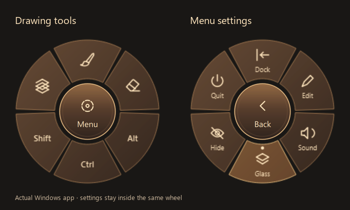
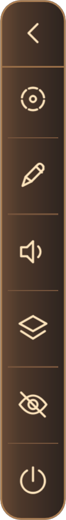
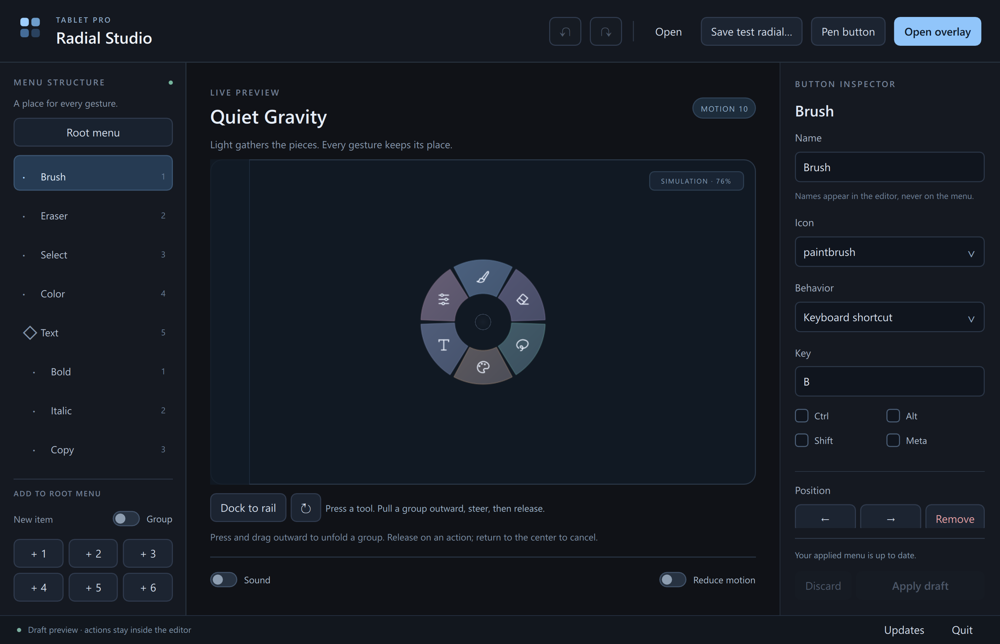
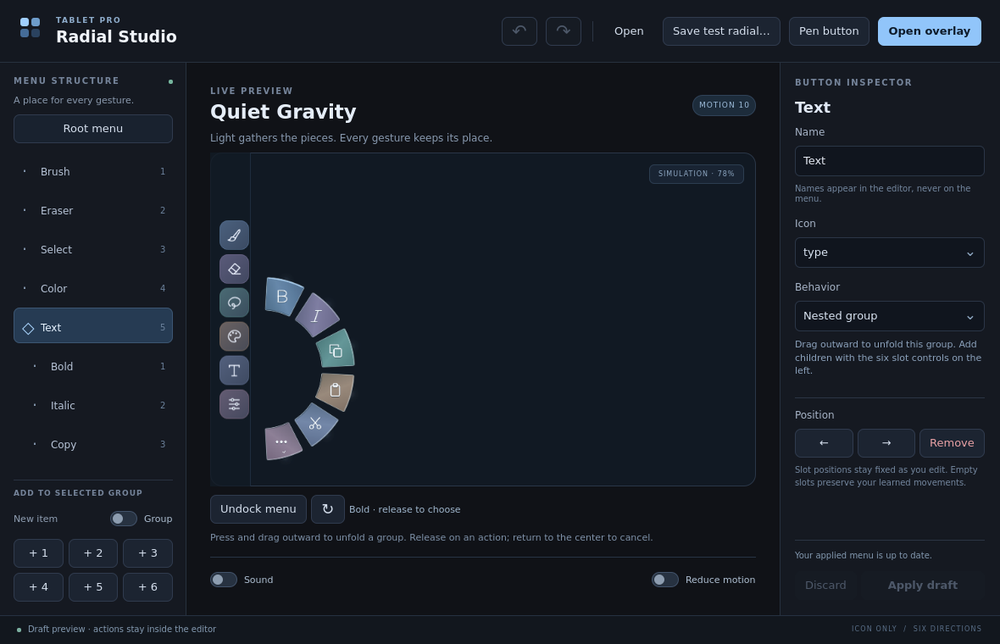

# Tablet Pro Radial

A native Windows radial menu and editor with pen-button invocation, a docked rail, live Glass backgrounds, and updates from this repository.

## Download for Windows

**[Download the latest Windows x64 installer](https://github.com/justicefrangipane/Tablet-Pro-Radial/releases/latest)**

Open the latest release and download the file ending in **Windows-x64-Setup.exe**. Run it on each computer. Setup installs for your Windows account and includes the Qt runtime; administrator access and a separate Qt installation are not required. The installer is currently unsigned.

The latest release is **[0.3.29](https://github.com/justicefrangipane/Tablet-Pro-Radial/releases/tag/v0.3.29)**, November 13, 2026.

Version **0.3.29** adds a Glass strength slider with a gentler 60% default, a matching modifier-lock sound for each of the twelve quiet sound styles, and fixes clipped radial button edges. It also includes the faster press-and-release ripple, live Glass during movement, sharper icons, smoother dragging, aligned docking, child menus that replace the floating ring, and one-click updates. Crystal whisper is the default sound; Watch tick is second in the list. The Windows installer, matching source archive, and checksums are available in the release above.

## Get updates

Right-click the bronze-and-ivory fan icon beside the Windows clock and choose **Updates**, or use **Updates** in the editor. The same logo appears in the taskbar, Start menu shortcuts, app executable, and installer. The app is preconfigured for **justicefrangipane/Tablet-Pro-Radial**.

Choose **Check now → Download update → Install update**. In **0.3.27**, the Install click closes Radial safely, runs the verified installer, and reopens automatically in the same docked, radial, or editor mode. No extra installer or Open now prompts are needed. Unapplied editor changes still offer Apply, Discard, or Keep editing first. Automatic checks notify you when a newer stable release is available. Downloads are checked against GitHub's SHA-256 digest before installation. Your saved menus and preferences are kept.

Choose **Update log** from the tray, editor, or Updates window to browse changes by version. The installed version is marked, and the included history works offline. Changes are grouped under **New**, **Improved**, and **Fixed**.

After installing a new version, **What's new** opens automatically on its first launch in radial, docked, or editor mode. It shows that version's changes once per Windows account. Choose **Let's go** to continue or **View update log** for the full history. Regular restarts and reinstalling the same version do not repeat it.

For the older 0.3.3 build, enter `justicefrangipane/Tablet-Pro-Radial` in its Updates dialog once, then check for updates. You can also install the latest release directly.

## Start using Radial

Use **Ctrl+Alt+Space** or your configured pen button to show or hide the menu. Hold the centered **ellipsis** to gently expand the center, then release to open **Dock, Edit, Sound, Glass, Hide, and Quit**. The floating ripple and bronze fill take 420 ms; docked settings fill in 360 ms. **Back** reverses that bloom into the ellipsis; toggling midway continues from the current frame. Drawing tools enable once the closing animation finishes. Glass stays visible through the motion. Closing the editor leaves Radial in the tray; **Quit** exits the app. Use only one Radial or Tablet Pro Studio instance at a time to avoid overlapping pen shortcuts.

Save your custom menu with **Save test radial…**, and use **Apply draft** to activate editor changes. See [Windows quick start](docs/RUN-WINDOWS.md) and [tray and updates](docs/TRAY-AND-UPDATES.md).

**Sound styles:** Below the editor preview, choose **Sound style**. The twelve choices are **Crystal whisper (default), Watch tick, Felt click, Walnut tap, Bamboo ticks, Tiny gears, Linen tick, Cork touch, Cedar knock, Bamboo bead, Porcelain touch, and Crystal hush**, in that order. **Preview** auditions the selected sound even with Sound off, without changing that preference. **Preview lock** auditions the matching quiet modifier-lock cue without holding a key. Style changes save immediately and are included in saved test documents. The settings center plays a quiet press, opens on release, and uses a closing sound with its reverse animation; the dock uses the same style. Pulling Alt, Ctrl, or Shift into hover-lock plays its confirmation once when the lock succeeds. The copper menu's **Sound** button remains a quick on/off switch.

**Glass strength (0.3.29):** In the bronze settings menu, drag outward from **Glass** (downward in the radial, rightward in the dock) to reveal a strength slider. Continue dragging to adjust it, or release and use the slider directly. Tapping Glass still toggles it on or off; pulling while it is off enables it for preview. Strength starts at **60%** and ranges from **0% to 100%**, with 100% matching the previous effect. Your adjustment saves independently of the toggle and is included in saved test documents.

**Pen trigger (0.3.27):** Quick-press the selected side button to open or hide the menu on release. Hold it for 500 ms to animate between docked and floating mode; releasing that hold keeps the menu visible. Every switch animates, including a smooth reversal if you switch again during the transition. Reduced motion switches immediately. The barrel button is selected by default. Change it in the **Pen trigger** row below the editor toolbar, choosing **Barrel button (default)** or **Invert / second button**. The switch turns pen-button input on or off, and choices save automatically. **Pen settings** opens live diagnostics. **Ctrl+Alt+Space** remains available.

The main default menu contains **Brush, Eraser, Alt, Ctrl, Shift, and Tools**. The Tools group retains selection, color, text, and editing shortcuts.

**Parent menus (0.3.27):** In the floating radial, **tap or slide outward** from a parent to replace the current ring with its children. Lift, then tap a child. Nested parents keep the same center; tap the center for **Back**, or drag it to move the whole menu. In the dock, sliding still opens a fan and holding for **300 ms** opens a child radial at the pen tip while the rail stays visible. Release the held dock parent to close its children. A child already chosen keeps its action or modifier. Esc closes the menu.

In **Edit**, select an action and choose **Make parent** to keep it as the first child of a new menu. Choose **Add child** to fill the next free slot, or **Add parent** to create another level. The six named child slots open their inspectors directly. Choose **Apply draft** when ready. These changes preserve customized menus and support Undo/Redo.

**Drag into a parent (0.3.15):** drag any button onto a parent in the menu list, or choose **Arrange buttons** and drag in the radial/docked preview. Green feedback means the drop is valid. The button moves into the first empty child slot; an existing parent moves with its whole child tree. The original slot stays empty. Drag near a list edge to scroll, press Esc to cancel, and use Undo to reverse a move. Full parents and loops are refused. If moving the last child leaves an empty parent, add a child or remove that empty parent before Apply. **Done arranging** restores the preview's hold/slide gestures.

- **Floating radial:** tap a modifier to hold it for the next pen stroke. Selecting it closes the wheel while keeping the modifier armed; lifting the next drawing stroke releases it. The selecting tap does not consume that stroke.
- **Drag out, in either layout:** the modifier stays on through tip lifts until the pen leaves hover range. A small lock marks the active state.
- **Docked rail:** hold for a momentary modifier or double-tap to keep it on until tapped again. Selecting actions keeps the dock visible; choosing a child closes its menu.

Held keys release when the menu is hidden, its pen button or shortcut is pressed, the editor opens, the target app changes, or Radial exits. They are not saved across restarts. Existing customized menus are preserved; **Use new default menu** loads the new layout as an undoable draft. Unchanged old defaults upgrade automatically.

Drag inside the center circle to move the radial. Tap its centered ellipsis for settings. The center has no rectangular hover highlight; tooltips use their own topmost, input-transparent window and stay inside the screen edges.

Glass fades outward by one quarter of the menu body's width (11 logical pixels for the dock, 50.5 for the radial), without enlarging its input area. Display layout, DPI and compositor changes trigger a coalesced graphics/mask/Glass rebuild. Physical Crystal reconnects and pen hardware still require device acceptance.

For quick edits, choose **Menu → Edit**, then tap the button to open its inspector. Select **Modifier key** as its behavior to assign Alt, Ctrl, or Shift, then **Apply draft**.



The docked **Continuous rail** keeps the tools and settings inside one 44 px housing. Tap **•••** at the top: Gentle bloom flows downward from the ellipsis, filling the rail with bronze and revealing ivory settings. Tap the back arrow to return to drawing. Neither animation expands the menu or its input boundary. Settings become interactive when the fill finishes; underlying drawing actions are disabled as soon as it begins. **Reduced motion** and the software renderer switch immediately.

<details>
<summary>See the Continuous rail</summary>

| Drawing tools | Settings |
| --- | --- |
|  |  |

</details>



## What is implemented

- Six fixed root slots, clear Alt/Ctrl/Shift labels, and nested groups with six fixed child slots. Removing a button leaves its slot empty; other gestures retain their positions.
- Floating parents open their children in place with a tap or outward pull. Dock parents retain hold-at-pen radials and slide-out fans. Independent pen/touch ownership, nested Back, and cancellation protect selection.
- Quiet Gravity: wedge surfaces and their icons break into small shaded voxels; light collects at the left rail, fragments travel toward each destination, and the reconstructed buttons settle with a restrained snap. Undocking reverses the same path.
- A separate editor with a menu hierarchy, icon/behavior inspector, root/group insertion, slot movement, subtree removal, undo/redo, Open, Save as, Discard, and Apply.
- Independent draft preview and applied runtime. Preview gestures report their action inside the editor. Apply validates and atomically persists a new profile; an active gesture finishes against its original snapshot.
- Shortcut, text, and held modifier actions, generated optional click/crackle cues, reduced motion, and persisted preferences. Sound starts muted.
- A separate non-activating Windows overlay with Ctrl+Alt+Space invocation, foreground-target checks, bounded input dispatch, and explicit failure reporting. Other operating systems use simulation.
- An isolated Windows HID helper using the supplied Tablet Pro library, with first/second side-button selection, rising-edge invocation, no repeated toggles while held, and cleanup when the parent exits. Native Wacom background capture is not assumed; the driver shortcut route uses the same menu.

## Build and publish an update

See the [release guide](docs/RELEASING.md). The Windows release uses Qt 6.11.1 / MinGW 13.1, plus Visual Studio C++ and the Windows SDK for the Glass bridge. Update the version in `CMakeLists.txt` and add its entry to `docs/update-history.json`, run the release build, then publish the verified installer with a matching `vMAJOR.MINOR.PATCH` tag. The bundled update log and default GitHub release notes use that same history file.

Source is included in every installer and attached separately to each release. The repository contains the editable application source; generated builds and installers are release assets.

## Build with CMake

With a desktop Qt kit available:

```sh
cmake -S . -B build -DCMAKE_BUILD_TYPE=Release -DCMAKE_PREFIX_PATH=/path/to/Qt/6.8.3/gcc_64
cmake --build build --parallel
ctest --test-dir build --output-on-failure
./build/tabletpro_radial
```

The core has no Qt dependency and can be built independently:

```sh
cmake -S . -B build-core -DTABLETPRO_BUILD_DESKTOP=OFF
cmake --build build-core --parallel
ctest --test-dir build-core --output-on-failure
```

## Try the editor

1. Select a node in **Menu structure**. Change its icon and behavior in **Button inspector**. Modifier keys also show Alt, Ctrl, or Shift on the menu. You can tap a preview button to select it, or right-click a runtime button to edit it directly.
2. Select **Root menu** to add a root button, or select a group to add one of its six children. Occupied slots cannot be overwritten. A newly created group must receive a child before it can be applied.
3. Open Tools, then press the Text icon in the preview and drag outward. Six child icons appear. Continue to a child and release; the status reports the action. Drag back through the parent to backtrack, or press Escape to cancel.
4. Use **Dock to rail** or the replay control to inspect Quiet Gravity. Try the same Text gesture from the rail, moving toward the canvas.
5. **Save as** exports a profile; **Apply draft** publishes and persists the runtime version. These are separate operations. **Discard** restores the applied version and can itself be undone.
6. On Windows, focus your drawing application and invoke the overlay with your selected pen side button or **Ctrl+Alt+Space**. Release those keyboard modifiers before completing a gesture. The runtime's editor control returns to the editor.

The included shortcuts are examples, not universal drawing-app mappings. Edit them for your application. Text actions support literal text; layout-dependent punctuation key shortcuts are deferred. No shell commands, scripts, or legacy AHK macros execute through this format.

The editor preview scales its canvas to fit smaller windows; its badge shows the zoom. This does not change runtime button sizes or gesture angles.



## Project map

| Location | Responsibility |
| --- | --- |
| `core/` | Qt-free model validation and deterministic gesture decisions |
| `app/` | Profile codec, editor transactions, preview/runtime sessions, audio, startup |
| `ui/` | Native icons, batched scene-graph voxel renderer, software fallback, pointer capture |
| `qml/` | Desktop editor and runtime overlay presentation |
| `platform/` | Windows window/input behavior; explicit simulation elsewhere |
| `vendor/tabletpro/` | User-supplied HID binaries and provenance; loaded only in the isolated helper |
| `examples/artist.radial.json` | Exported schema-1 starter profile |
| `tests/` | Core, editor/format, and non-Windows platform-simulation checks |
| `scripts/` | Windows build, validation, and packaging entry point |

See [architecture](docs/ARCHITECTURE.md), [profile format](docs/PROFILE-FORMAT.md), [implementation status](docs/STATUS.md), and [existing app audit](docs/EXISTING-APP-AUDIT.md).

## Scope retained for later

Legacy Tablet Pro import belongs in a separate translator into the new model. macOS native dispatch, iOS/custom-keyboard hosting, direct Wacom background capture, additional dock edges, automatic layout adaptation, repeating actions, arbitrary macros, and app-specific profile switching are not implemented in this version. The core and platform boundary leave room for them without embedding those concerns into gesture geometry.

The Unfolded Bible palette source was not available in the supplied files. The motion and renderer here are new code; no reuse of that source is claimed.
